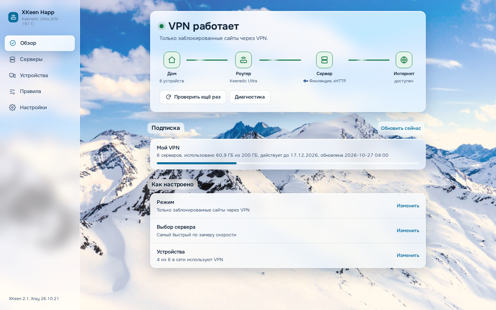
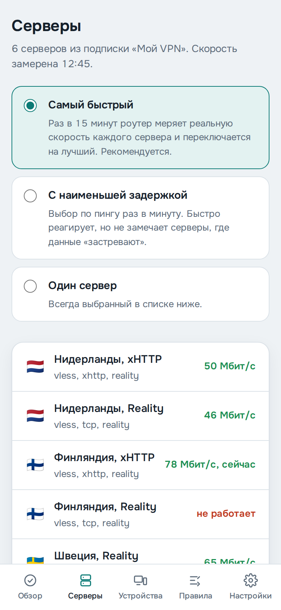
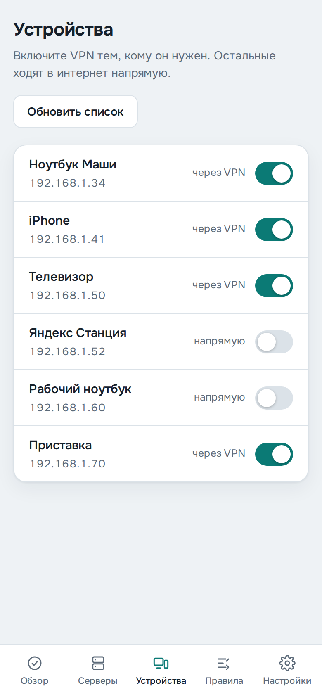
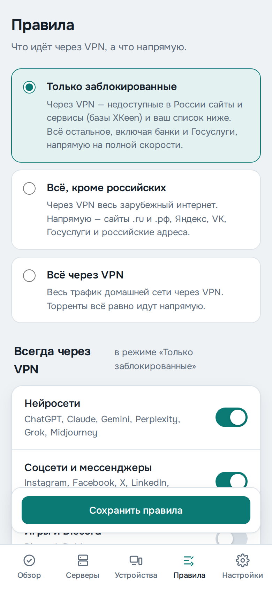
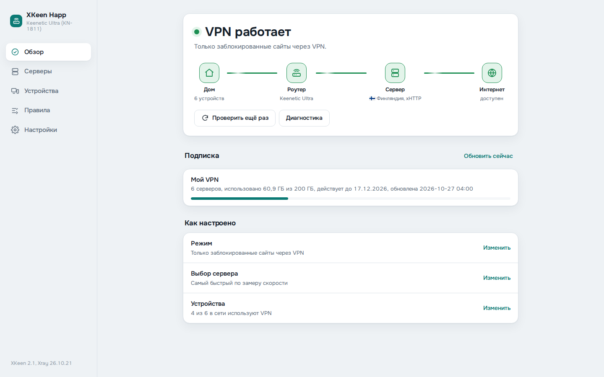

# XKeen Happ

Панель для роутеров **Keenetic** и **Netcraze**, которая превращает роутер в VPN-клиент для всего дома. Вставляете ссылку на подписку своего VPN-сервиса — роутер сам настраивает [XKeen](https://github.com/jameszeroX/XKeen) и Xray, выбирает самый быстрый сервер и следит, чтобы VPN работал. Приложения на телефонах, телевизорах и приставках не нужны.

<p>


</p>

## Установка за 3 минуты

**Нужно:** роутер Keenetic или Netcraze с USB-портом, флешка, ссылка на подписку VPN-сервиса (та же, что для приложения Happ или v2rayTun).

### Если Entware уже стоит

Подключитесь к роутеру по SSH (логин `root`, пароль `keenetic`, порт `222` или `22`) и вставьте одну строку:

```sh
curl -fsSL https://github.com/O1ezhan/xkeen-happ/releases/latest/download/install.sh | sh -s -- --sub "ВАША_ССЫЛКА_НА_ПОДПИСКУ"
```

Всё остальное установщик сделает сам. В конце он покажет адрес панели — обычно `http://192.168.1.1:8099`.

Не хотите набирать команды? Скачайте из [последнего релиза](https://github.com/O1ezhan/xkeen-happ/releases/latest) `deploy-windows.bat` (Windows 10/11) или `deploy-unix.sh` (macOS, Linux) и запустите — спросит IP роутера и пароль, остальное сделает сам.

### Если Entware нет — флешкой

Архив для флешки — это «стартовый пакет»: в нём уже есть Entware, XKeen, Xray и базы сайтов, поэтому роутеру не нужен доступ к репозиторию Entware и GitHub (без VPN они открываются не у всех). Интернет нужен только чтобы скачать подписку.

1. Узнайте процессор роутера по таблице ниже и скачайте из [релиза](https://github.com/O1ezhan/xkeen-happ/releases/latest) файл `aarch64-installer.tar.gz`, `mipsel-installer.tar.gz` или `mips-installer.tar.gz`.
2. Отформатируйте флешку в **EXT4** (на компьютере или в роутере: «Приложения» → «Диски и принтеры»).
3. Создайте на флешке папку `install` и положите туда скачанный файл.
4. Вставьте флешку в роутер: «Управление» → «OPKG» → выберите флешку → «Сохранить».
5. Через 5–10 минут откройте `http://<адрес роутера>:8099` (обычно `192.168.1.1` или `192.168.0.1`), задайте пароль и вставьте подписку.

| Архив | Модели |
|---|---|
| `aarch64` | **Netcraze:** Ultra (NC-1812), Giga (NC-1012), Hopper (NC-3811), Hopper SE (NC-3812)<br>**Keenetic:** Peak (KN-2710), Titan (KN-1811), Hero (KN-1012), Hopper (KN-3811), Hopper SE (KN-3812) |
| `mipsel` | **Netcraze:** Viva (NC-1913)<br>**Keenetic:** Hopper (KN-3810), Hero 4G (KN-2310), Hero 4G+ (KN-2311), Skipper 4G (KN-2910), Giga (KN-1010, KN-1011), Ultra (KN-1810), Viva (KN-1910), Extra (KN-1710, KN-1711), KN-1410, KN-2610 |
| `mips` | **Keenetic:** Skipper DSL (KN-2112), Hopper DSL (KN-3610), DSL (KN-2010), Duo (KN-2110, KN-2111), KN-2410, KN-2510 |

Таблица составлена по справке Keenetic и Netcraze (статья «Установка Entware на USB-накопитель» для каждой модели). Нужны USB-порт и роутер в режиме «Интернет-центр». Модели без USB (Start, Lite, City, Air и т. п.) не подходят.

Если вашей модели нет в таблице, откройте на [support.keenetic.com](https://support.keenetic.com/) или [support.netcraze.ru](https://support.netcraze.ru/) статью своей модели про установку Entware на USB: там написано, какой архив нужен. Если выбрали не тот файл — роутер просто не начнёт установку, ничего не сломается.

### Компоненты прошивки

Если установщик напишет, что не хватает компонентов, включите их в веб-интерфейсе роутера: «Общие настройки» → «Изменить набор компонентов»:

- «Поддержка открытых пакетов»;
- «Модули ядра подсистемы Netfilter»;
- «Пакет расширения Xtables-addons для Netfilter»;
- по желанию — «DNS-over-TLS прокси» и «DNS-over-HTTPS прокси».

Роутер перезагрузится — после этого запустите установку ещё раз.

## Что умеет

**Сам выбирает сервер.** Раз в 15 минут роутер меряет реальную скорость каждого сервера подписки и переключается на самый быстрый работающий. Если сервер «завис», проверка VPN это замечает, и роутер перемеривает серверы сразу, не дожидаясь замера по расписанию.

**Проверяет, что VPN работает.** После любого изменения роутер отправляет тестовый запрос через VPN. Не прошёл — сам возвращает прежний рабочий конфиг.

**Три режима:**
- *только заблокированные* — через VPN идут сайты, недоступные в России, остальное, включая банки и Госуслуги, напрямую на полной скорости;
- *всё, кроме российских* — напрямую идут .ru, .рф, Яндекс, VK, Госуслуги;
- *всё через VPN*.

Готовые наборы сайтов одним переключателем: нейросети, соцсети, игры, видео и музыка. Свои сайты — списком.

**Аналитика.** Графики скорости каждого сервера за сутки, неделю и месяц, рейтинг серверов, доступность VPN по времени, трафик через VPN и напрямую, журнал переключений. Данные копит сам роутер (около 1 МБ за 30 дней), графики рисует браузер — роутер почти не нагружается.

**Устройства.** Каждому устройству в доме — свой переключатель: через VPN или напрямую. Например, рабочий ноутбук или Яндекс Станция — напрямую.

**Уведомления в Telegram:** VPN перестал работать, Xray упал, подписка не обновилась, подписка заканчивается через 3 дня.

**Обслуживание без консоли:** обновление XKeen, Xray, баз сайтов и самой панели кнопкой; kill switch; диагностика одной кнопкой с отчётом, который удобно отправить в поддержку; перенос всех настроек на другой роутер одним файлом.

**Подписки как в Happ:** ссылки `https://` (Base64 или текст), трафик и срок подписки, сообщения сервиса, привязка по устройству (HWID). Протоколы VLESS (Reality, TLS, Vision), VMess, Trojan, Shadowsocks, Hysteria2 (если её поддерживает установленный Xray); транспорты xHTTP, WebSocket, gRPC, TCP, HTTPUpgrade.

<p>



</p>

## Что меняется в роутере

- Создаётся политика доступа **XKeen**, в неё переводится домашняя сеть. Если у домашней сети уже есть своя политика, она не меняется.
- Для режима «напрямую» у устройств создаётся политика **XKeen-Direct**.
- Добавляются DNS-over-TLS/HTTPS Cloudflare и Google — только если установлены компоненты и вы не настраивали свои.
- Включается автозапуск Entware.
- В `/opt` ставятся `curl`, `jq`, `ca-bundle`, `lighttpd`, XKeen и Xray. Панель слушает порт `8099` только в домашней сети.

Параметры установщика: `--sub ССЫЛКА`, `--mode blocked|except_ru|full`, `--select auto|manual`, `--no-policy` (не трогать политики), `--no-dns` (не трогать DNS), `--skip-xkeen` (XKeen ставите сами). Повторный запуск безопасен.

## Безопасность

- Пароль панели задаётся при первом входе (в течение суток после установки). Без входа панель ничего не показывает и не меняет. Чужой сайт, открытый у вас дома, управлять панелью не может.
- Подписка и обновления скачиваются только по HTTPS с проверкой сертификата; в журнал ссылка подписки не пишется.
- Смените пароль `root` в Entware командой `passwd` — по умолчанию он у всех одинаковый.

Забыли пароль панели: по SSH `rm /opt/etc/xkeen-happ/auth.json && touch /opt/etc/xkeen-happ/allow-setup`, затем откройте панель и задайте новый.

Подробности проверки кода — в [AUDIT.md](AUDIT.md).

## Если что-то не работает

Нажмите «Диагностика» на главной странице панели — она проверит всё по шагам и подскажет, что исправить. То же по SSH: `xkeen-happ-doctor`.

| Признак | Что делать |
|---|---|
| Панель не открывается | `xkeen-happ-doctor`; перезапуск: `/opt/etc/init.d/S99xkeen-happ restart` |
| «VPN не пропускает трафик» | Серверы → «Самый быстрый»; или выберите другой сервер вручную |
| «Не удалось скачать подписку» | Откройте ссылку в браузере — работает ли она; не истекла ли подписка |
| Флешка не запускает установку | Файл под ваш процессор? Раздел EXT4? «Системный журнал» роутера, строки `installer` |

## Удаление

```sh
xkeen-happ-uninstall         # убрать панель, XKeen оставить
xkeen-happ-uninstall --all   # убрать всё, включая XKeen
```

Политики «XKeen» и «XKeen-Direct» удалите в веб-интерфейсе роутера («Приоритеты подключений»).

## Для разработчиков

```sh
sh scripts/build-release.sh   # dist/: install.sh, архивы для флешки, zip
```

Релиз собирается автоматически GitHub Actions при теге `vX.Y.Z` (версия — в файле `VERSION`). Нужны `sh`, `curl`, GNU `tar`, `gzip`, `base64`, `jq`, `python3`.

Код: `opt/bin/xkeen-sub` — подписки и конфиги Xray, `xkeen-happ-ctl` — проверка VPN, откат, уведомления, обновления, `xkeen-rci-setup` — настройка роутера через NDMS, `xkeen-happ-setup` — установка, `opt/share/xkeen-happ/www` — панель.

## Благодарности и лицензия

[XKeen](https://github.com/jameszeroX/XKeen) — jameszeroX, [Xray-core](https://github.com/XTLS/Xray-core) — XTLS, [Entware](https://entware.net/), шрифт [Onest](https://github.com/simpletype-ru/Onest) (SIL OFL), флаги — [Twemoji](https://github.com/twitter/twemoji) через [Twemoji Country Flags](https://github.com/talkjs/country-flag-emoji-polyfill) (CC BY 4.0), фото гор — [MonikaP, Wikimedia Commons](https://commons.wikimedia.org/wiki/File:Snowy_mountain_range.jpg) (CC0). Проект не связан с Happ, Keenetic и Netcraze; названия принадлежат их владельцам.

Лицензия MIT, см. [LICENSE](LICENSE).
